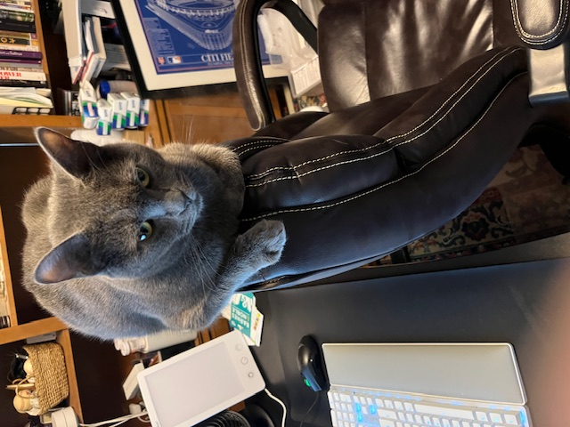
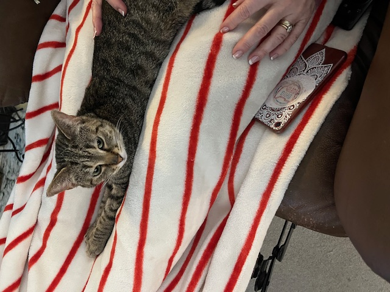

# Quiz 2 Information

- All links to Quiz 2 materials are now available on this page.
- If you have any question at all about Quiz 2, email it to **431-help at case dot edu**.
    - All email received there from Monday 2026-11-23 through Saturday 2026-11-28 will be answered on Sunday 2026-11-29.
- Quiz 2 is due at **4 PM on Monday 2026-11-30**.

## NEW! Questions and Answers relevant to Quiz 2

- On **missingness**: The number of rows in the cats1 data set is 999. The number of rows after filtering to complete cases is different than 999.
    - There are **eight** main analyses described in the Quiz (Questions 5-7, Questions 8-9, Questions 10-12, Questions 13-16, Questions 17-18, Questions 19-20, Questions 21-22, and finally Questions 23-27).
    - You should start your work on each of those analyses with 999 rows. Some analyses, either because they include variables with missing data, or for other reasons specified in the instructions, may wind up with fewer than 999 rows. 
- What **units of measurement** should we use for the F1_, F2_, F3_ and F4_ variables? Points.
- Q09: A correct answer to Q09 will provide us the name of a specified cell and then with six numbers (3 observed, and 3 expected).
- Q15-Q16: All five response sets (A-E) do provide both a point estimate and 89% uncertainty interval estimate in the provided output.
- Q22: Q22 is about Pr(catching at least one animal), and not about Pr(catching exactly one animal) throughout.

## Quiz Materials

1. The Quiz [instructions and questions are now posted](https://github.com/THOMASELOVE/431-quiz-2026/blob/main/quiz2/431-2026-quiz2.pdf) as a **29-page** PDF document, which includes detailed instructions, and all 30 questions.
    - In addition, there are two bonus questions (clearly marked as bonus) at the end of the Quiz.
        - Neither will improve your Quiz grade. Each will improve your end-of-semester bonus if you build a good response.
        - It's your choice to do both, either or none of the bonus questions.
2. I have provided **two** data sets (called **cats1.xlsx** and **q28_data.csv**) that are mentioned in the Quiz. These can either be downloaded from [our 431-data page](https://github.com/THOMASELOVE/431-data), or found in our Shared Drive in the **431 Quiz 2** folder's data sub-folder.
3. You will provide your responses using [this Google Form Answer Sheet](https://tinyurl.com/431-2026-quiz2-form).
    - The link to the Answer Sheet form is <https://tinyurl.com/431-2026-quiz2-form>.
    - The form will close at 4:15 PM on 2026-11-30 and will not reopen.

---------

## Getting Help

During the Quiz period (5 PM 2026-11-19 through 4 PM 2026-11-30) we will not answer questions about the Quiz in TA office hours, or in any other way. Some cautions:

- I **do not guarantee** to answer email I receive from Monday 2026-11-23 through Saturday 2026-11-28 **until** Sunday 2026-11-29.
- Specific questions are more likely to get helpful answers.
- I will not review your code or your English for you.
- I will not tell you if your answer is correct, or if it is complete.
- I will email all students **on Sunday 2026-11-29** if we find an error in the Quiz that needs fixing between now and then.

## Special Instructions for Quiz 2

**Unless otherwise specified in the Question**, do the following on Quiz 2:

- Any time you need to **set a random seed**, set it to `4312026`, please.
- All uncertainty intervals you develop for this Quiz should use **89%** as their confidence level. 
- Round all answers to 2 decimal places.
- Use 1,000 replications any time you use a bootstrap.
- Do not include the `library` command at any time for your responses on the Quiz that ask for code. 
- Occasionally, we ask you to provide a single line of code. If not otherwise specified, a single line of code in response can contain **at most** three pipes, although you may or may not need the pipe in any particular setting. I exclusively used the `|>` pipe, and not the `%>%` pipe, in developing this Quiz, but you may use either.
- Assume in all questions that all packages listed below are loaded in R.

## R packages code chunk

Here is the code chunk listing R packages from page 6 of the Quiz 2 Instructions, so you can copy and paste it into RStudio.

```{r}
#| message: false

knitr::opts_chunk$set(comment = NA)

library(here)
source(here("data/Love-431.R"))

library(broom) 
library(car) 
library(DescTools) 
library(Epi) 
library(GGally)
library(gt)
library(glue)
library(janitor)
library(naniar)
library(mice) 
library(MKinfer)
library(olsrr)
library(patchwork)
library(pwr)
library(readxl) 
library(rstanarm)
library(easystats)
library(tidyverse)

theme_set(theme_bw())
```

## Our cats

Our cats are Josephine (above) and Rose Maybud (below). Here are a couple of pictures from February 2025, when Josie was about 1.5 and Rosie was new to us and just a year old. We rescued them. They are named for Gilbert & Sullivan characters. Josie likes me. Rosie likes my wife.





